# 🚀 B2B Lead Intelligence Engine

[](https://www.python.org/)
[](https://www.docker.com/)
[](https://fastapi.tiangolo.com/)
[](https://cloud.google.com/bigquery)
[](https://n8n.io/)
[](https://docs.pytest.org/)
[](https://lookerstudio.google.com/)

An end-to-end, enterprise-grade **Analytics Engineering & Lead Intelligence Pipeline**. 

Engineered to solve stale B2B company databases by asynchronously scraping web directories, validating strict schema contracts, orchestrating lead enrichment workflows, and persisting warehouse-ready records into **Google Cloud BigQuery** under a **Kimball Star Schema** dimensional model.

---

## 🏗️ Architecture & Data Flow

```mermaid
flowchart LR
    A["Target B2B Directory"] -->|Async HTTP / BS4| B["Scraper Engine (Python 3.11 / Docker)"]
    B -->|HTTP POST Batch Payload| C["n8n Orchestration Engine"]
    C -->|Split Out Items| D["Contact & Role Enrichment"]
    D -->|POST /api/v1/load-lead| E["FastAPI Ingestion Microservice"]
    E -->|BigQuery Load Job - NDJSON| F[("BigQuery DW: stg_b2b_leads")]
    F -->|SQL Dimensional Modeling| G[("Star Schema Views - Kimball")]
    G --> H["Looker Studio BI Dashboard"]
```



---

## 🧩 Pipeline Layers & Engineering Decisions

### 1. Ingestion & Extraction Layer (`scraper/`)
* **Asynchronous Non-blocking I/O:** Built with `httpx.AsyncClient` and Python's `asyncio` for high-throughput batch extraction.
* **Defensive Web Scraping:** Parses HTML cards hierarchically with `BeautifulSoup4`. Extracts attributes safely using fallback defaults and transforms empty strings into true database `NULL` (`None`) values.
* **Strict Data Contracts:** Powered by **Pydantic v2** (`CompanyLead`). Guarantees required fields (`name`, `website`, `industry`) and graceful handling of missing optional metadata (`description`).

### 2. Workflow Orchestration & Enrichment (`workflows/`)
* **Decoupled Workflow (`n8n`):** Receives raw batches via webhook, utilizes a **Split Out** node for item-level parallelism, cleans domain artifacts, synthesizes corporate contact emails (`contact@<domain>`), and maps target decision-makers (`CEO / Founder`).
* **Zero External Rate Limits:** Streamlined local enrichment avoiding public echo-service bottlenecks and 429 rate limit exceptions.

### 3. Ingestion Microservice (`scraper/src/load_stg_bigquery.py`)
* **FastAPI Endpoint:** Exposes a validated REST endpoint (`POST /api/v1/load-lead`) with UTC audit timestamps (`ingested_at`).
* **BigQuery Sandbox Optimization:** Ingests data via Google Cloud BigQuery Python SDK using **Batch Load Jobs** (`load_table_from_json` with `WRITE_APPEND`). This architectural decision completely circumvents DML (`INSERT INTO`) restrictions enforced by BigQuery Sandbox accounts, enabling 100% free cloud ingestion.

### 4. Analytics Engineering & Dimensional Modeling (`sql/`)
Modeled according to Ralph Kimball's Dimensional Modeling standards into a **Star Schema** deployed as BigQuery analytical views:

```
                  ┌──────────────────────┐
                  │       dim_time       │
                  │   (Calendar Master)  │
                  └──────────┬───────────┘
                             │
                             │ (sk_time)
                             ▼
┌──────────────────┐    ┌───────────────────────────┐    ┌────────────────────────┐
│  dim_companies   │◄───┤    fct_leads_enrichment   ├───►│  dim_decision_makers  │
│ (Deduplicated MD5)    │    (Ingestion & Metrics)  │    │  (Deduplicated MD5)    │
└──────────────────┘    └───────────────────────────┘    └────────────────────────┘
```

* **`stg_b2b_leads`:** Raw immutable staging table storing all ingested records.
* **`dim_time`:** Calendar dimension generated from `2024-01-01` to `2030-12-31`, establishing surrogate key `sk_time` (`YYYYMMDD`).
* **`dim_companies`:** Company dimension deduplicated by domain using surrogate key `company_id = TO_HEX(MD5(LOWER(TRIM(website))))`. Tracks first-seen timestamp and `sk_time`.
* **`dim_decision_makers`:** Prospect dimension deduplicated by corporate email with `decision_maker_id = TO_HEX(MD5(LOWER(TRIM(contact_email))))`.
* **`fct_leads_enrichment`:** Fact table capturing each ingestion event with surrogate foreign keys (`sk_time`, `company_id`, `decision_maker_id`) and calculated metrics such as `is_enriched`.

### 5. BI & Executive Dashboard (`Looker Studio`)
* Native BigQuery connection analyzing **Lead Volume by Sector**, **Enrichment Success Rate (%)**, and **Monthly Ingestion Growth**.

---

## 🧪 Automated Testing Suite (`pytest`)

The project implements automated unit tests located in `scraper/tests/test_parser.py`:

* **Data Contract Validation:** Asserts required fields trigger `pydantic.ValidationError` when missing and validates `Optional[str]` handling.
* **Catalog Fixture Verification:** Verifies end-to-end extraction accuracy against the reference dataset (`b2b_catalog.html`).
* **Resilience Testing:** Validates that malformed HTML cards (missing links or headers) are skipped safely without raising unhandled runtime exceptions.

Execute the test suite locally:
```bash
pytest scraper/tests
```

---

## 🚀 Quick Start (Local Setup)

### Prerequisites
* **Python 3.11+** installed
* **Docker Desktop** installed and running
* Google Cloud Platform service account key (`gcp_key.json`) with BigQuery Admin / Data Editor permissions.

---

### Step 1: Clone the Repository
```bash
git clone https://github.com/DFelipedias/b2b-lead-intelligence-engine.git
cd b2b-lead-intelligence-engine
```

### Step 2: Install Python Dependencies
```bash
pip install -r scraper/requirements.txt
```

### Step 3: Run the Ingestion Microservice (FastAPI)
```bash
# Set your Google Cloud credentials
$env:GOOGLE_APPLICATION_CREDENTIALS = "gcp_key.json" # PowerShell
# export GOOGLE_APPLICATION_CREDENTIALS="gcp_key.json" # Linux/macOS

python -m uvicorn scraper.src.load_stg_bigquery:app --host 0.0.0.0 --port 8000
```
Interactive API documentation available at: `http://localhost:8000/docs`

### Step 4: Run the Workflow in n8n
1. Open your local `n8n` instance (`http://localhost:5678`).
2. Import the workflow from `workflows/b2b-lead-enrichment-pipeline.json`.
3. Activate the workflow or click **Listen for test event**.

### Step 5: Execute the Scraper

**Option A — Running via Docker (Recommended):**
```bash
docker build -t lead-scraper ./scraper
docker run --rm lead-scraper
```

**Option B — Running Directly with Python:**
```bash
python scraper/src/main.py
```

---

## 📁 Repository Structure

```text
b2b-lead-intelligence-engine/
├── scraper/
│   ├── Dockerfile                   # Container definition for scraping microservice
│   ├── requirements.txt             # Pinned production & testing dependencies
│   ├── src/
│   │   ├── main.py                  # Async scraping engine & webhook dispatcher
│   │   ├── models.py                # Pydantic v2 data contracts
│   │   ├── b2b_catalog.html         # Test catalog fixture with realistic company profiles
│   │   └── load_stg_bigquery.py     # FastAPI microservice for BigQuery ingestion
│   └── tests/
│       └── test_parser.py           # Pytest suite (data contracts & parser resilience)
├── sql/
│   ├── create_stg_b2b_leads.sql     # DDL for BigQuery staging table
│   └── create_analytics_layers.sql  # Kimball Star Schema views (dim_time, dim_*, fct_*)
├── workflows/
│   └── b2b-lead-enrichment-pipeline.json # Complete n8n batch workflow
├── .gitignore                       # Ignored secrets, virtualenvs, and test caches
└── README.md                        # Project documentation & architecture overview
```

---

## 👨‍💻 Author

Developed by **Felipe Dias**  
*Data Engineer | End-to-End Data Solutions*  
[GitHub Profile](https://github.com/DFelipedias)
